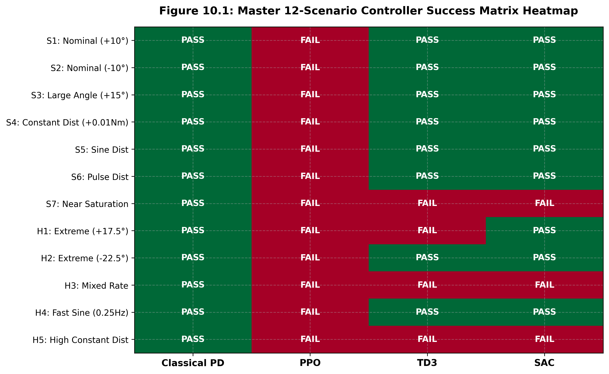
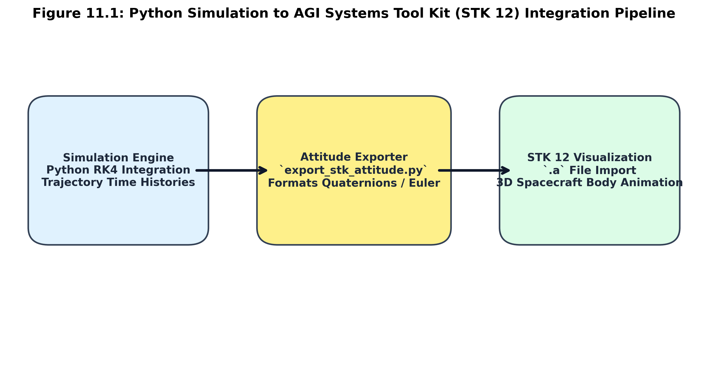

# AI-Driven Spacecraft Attitude Stabilization Using Deep Reinforcement Learning

[](https://www.python.org/)
[](https://pytorch.org/)
[](https://gymnasium.farama.org/)
[](tests/)
[](STK/)

A rigorous academic research repository comparing **Classical Proportional-Derivative (PD)** control with continuous **Deep Reinforcement Learning (PPO, TD3, and SAC)** for single-axis spacecraft attitude stabilization under electromechanical reaction-wheel actuator constraints.

---

## Academic & Research Identification

* **Research Author:** **Ahmed Farahat**  
  *M.Sc. Student — Aircraft Overall Design*  
  School of Astronautics, **Beihang University**
* **Course:** Spacecraft Control
* **Course Lecturer:** **Yang Chen**
* **Institution:** Beihang University, Beijing, China

---

## Table of Contents
1. [Research Overview](#research-overview)
2. [Research Contributions](#research-contributions)
3. [Physical Model & Equations of Motion](#physical-model--equations-of-motion)
4. [Software Architecture & Pipeline](#software-architecture--pipeline)
5. [Control Architectures: Classical vs Deep RL](#control-architectures-classical-vs-deep-rl)
6. [Training Configurations & Hyperparameters](#training-configurations--hyperparameters)
7. [Experimental Benchmark Suite](#experimental-benchmark-suite)
8. [Comparative Results & Key Findings](#comparative-results--key-findings)
9. [Systems Tool Kit (STK 12) Integration](#systems-tool-kit-stk-12-integration)
10. [Installation & Setup](#installation--setup)
11. [Running Experiments & Examples](#running-experiments--examples)
12. [Limitations & Boundary Assumptions](#limitations--boundary-assumptions)
13. [References & Citations](#references--citations)

---

## 1. Research Overview

Spacecraft Attitude Determination and Control Systems (ADCS) are mission-critical subsystems requiring micro-radian pointing precision and robust disturbance rejection. Reaction wheels provide fine internal torque exchange by accelerating an internal rotor via an electric motor. However, real spacecraft actuators suffer from strict electromechanical limitations:
- **Motor Torque Saturation:** Peak torque is bounded by motor electrical limits ($\pm 0.055\text{ Nm}$).
- **Rotor Speed Saturation:** Maximum momentum capacity is limited by mechanical rotor speed ($\pm 5500\text{ RPM}$).
- **Momentum Conservation:** Reaction wheels cannot alter the total angular momentum of the spacecraft without external torques (e.g., thrusters or magnetic torquers).

While classical linear controllers (PD/PID) have flown successfully for decades, emerging missions demand autonomous adaptation to unmodeled space disturbances. This research provides a scientifically defensible comparative evaluation between an analytically tuned **Classical PD Controller** and three modern continuous Deep Reinforcement Learning algorithms:
1. **Proximal Policy Optimization (PPO)** — On-policy clipped surrogate baseline.
2. **Twin Delayed Deep Deterministic Policy Gradient (TD3)** — Off-policy deterministic actor-critic with twin Q-networks.
3. **Soft Actor-Critic (SAC)** — Off-policy maximum-entropy stochastic actor-critic.

---

## 2. Research Contributions

1. **Validated RK4 Physics Engine:** High-fidelity single-axis rotational dynamics with reaction wheel internal momentum exchange and parametric environmental disturbances.
2. **Analytical Classical PD Baseline:** Rigorously tuned continuous PD controller achieving a well-damped damping ratio ($\zeta = 0.89$) and 100% stabilization across all 12 test scenarios.
3. **Gymnasium RL Environment:** Continuous normalized observation and action spaces with anti-windup observation states and wheel speed penalty boundaries.
4. **Mathematical Anti-Symmetric Actor:** Custom neural policy architecture enforcing $\pi_{sym}(s) = rac{1}{2}(\pi(s) - \pi(-s))$, mathematically eliminating directional bias between positive and negative attitude errors.
5. **Multi-Seed Off-Policy Benchmark:** 3 independent random seeds across 500,000 steps each ($3,000,000$ cumulative off-policy training steps).
6. **STK 12 Mission Integration:** Automated pipeline exporting simulation trajectories into standard Ansys STK 12 `.a` attitude ephemeris files for 3D orbital animation.
7. **Automated Verification:** 85/85 unit, integration, and physics regression tests passing cleanly.

---

## 3. Physical Model & Equations of Motion

The spacecraft is modeled as a rigid body rotating about an inertial principal axis of inertia (Z-axis / yaw):

$$\begin{aligned}
J \ddot{\theta} &= M_d(t) - u(t) \\
\dot{\Omega} &= \frac{u(t)}{I_w} \\
H &= J \dot{\theta} + I_w \Omega = \text{const} \quad (\text{when } M_d = 0)
\end{aligned}$$

where:
- $J = 10.05\text{ kg}\cdot\text{m}^2$: Spacecraft bus moment of inertia.
- $I_w = 0.05\text{ kg}\cdot\text{m}^2$: Reaction wheel rotor moment of inertia.
- $\theta(t)$: Spacecraft attitude angle [rad].
- $\dot{\theta}(t)$: Spacecraft body angular rate [rad/s].
- $\Omega(t)$: Reaction wheel rotor speed [rad/s].
- $u(t)$: Internal motor torque applied to the wheel [$\text{N}\cdot\text{m}$].
- $M_d(t)$: External environmental disturbance torque [$\text{N}\cdot\text{m}$].

### Actuator Envelopes & Constraints
- **Torque Limit:** $|u(t)| \le \tau_{\max} = 0.055\text{ N}\cdot\text{m}$.
- **Speed Limit:** $|\Omega(t)| \le \Omega_{\max} = 5500\text{ RPM} \approx 575.96\text{ rad/s}$.
- **Numerical Integration:** 4th-order Runge-Kutta (RK4) with fixed timestep $\Delta t = 0.01\text{ s}$.

---

## 4. Software Architecture & Pipeline

```text
State Observation [theta, theta_dot, Omega, e_I]
                │
                ▼
        GNC Controller (PD / PPO / TD3 / SAC)
                │ Commanded Torque u_cmd
                ▼
      Actuator Non-Linearities & Saturation
        • Torque clipping: [-0.055, +0.055] Nm
        • Speed barrier: +/- 5500 RPM hard lock
                │ Applied Torque u(t)
                ▼
        RK4 Spacecraft Dynamics Engine
        • J * theta_ddot = Md(t) - u(t)
        • Omega_dot = u(t) / Iw
                │ Updated State
                ▼
   Telemetry Logger & STK Attitude Exporter (.a)
```

---

## 5. Control Architectures: Classical vs Deep RL

### Classical PD Controller
Continuous linear state feedback:
$$u(t) = K_p \theta(t) + K_d \dot{\theta}(t)$$
Tuned parameters: $K_p = 5.0\text{ N}\cdot\text{m/rad}$, $K_d = 8.0\text{ N}\cdot\text{m}\cdot\text{s/rad}$, natural frequency $\omega_n = 0.705\text{ rad/s}$, damping ratio $\zeta = 0.89$.

### Proximal Policy Optimization (PPO)
On-policy clipped surrogate objective with Generalized Advantage Estimation ($\lambda = 0.95, \gamma = 0.998$). Employs custom anti-symmetric actor MLP [64, 64] with Tanh activations.

### Twin Delayed DDPG (TD3)
Off-policy deterministic policy gradient with twin Q-critics to counter overestimation bias, delayed policy updates ($d=2$), and target policy smoothing noise. Champion model: Seed 123 @ 350,000 steps.

### Soft Actor-Critic (SAC)
Off-policy maximum-entropy actor-critic with entropy regularization and automatic temperature auto-tuning ($lpha$). Promotes smooth, chatter-free control signals. Champion model: Seed 123 @ 250,000 steps.

---

## 6. Training Configurations & Hyperparameters

| Hyperparameter | PPO Baseline | TD3 Champion | SAC Champion | Classical PD |
| :--- | :--- | :--- | :--- | :--- |
| **Algorithm Class** | On-Policy DRL | Off-Policy DPG | Off-Policy Max-Entropy | Linear Feedback |
| **Actor Architecture** | Anti-Sym [64, 64] Tanh | Anti-Sym [256, 256] ReLU | Anti-Sym [256, 256] ReLU | $K_p=5.0, K_d=8.0$ |
| **Critic Architecture** | MLP [64, 64] Tanh | Twin Critics [256, 256] | Twin Critics [256, 256] | None |
| **Learning Rate** | $3 \times 10^{-4}$ | $3 \times 10^{-4}$ | $3 \times 10^{-4}$ | Analytical |
| **Discount Factor ($\gamma$)** | 0.998 | 0.995 | 0.995 | N/A |
| **Replay Buffer Size** | N/A (On-Policy) | 200,000 | 200,000 | N/A |
| **Batch Size** | 64 | 256 | 256 | N/A |
| **Target Update ($	au$)** | N/A | 0.005 | 0.005 | N/A |
| **Seeds Evaluated** | 42, 123, 2026 | 42, 123, 2026 | 42, 123, 2026 | Deterministic |
| **Total Timesteps** | 500,000 / seed | 500,000 / seed | 500,000 / seed | Real-Time |

---

## 7. Experimental Benchmark Suite

Evaluated across a comprehensive suite of **12 distinct scenarios** under a strict $\pm 0.20^\circ$ pointing criterion:

### Nominal Validation Scenarios (S1–S7)
- **S1:** Nominal $+10.0^\circ$ initial error, zero disturbance.
- **S2:** Nominal $-10.0^\circ$ initial error, zero disturbance.
- **S3:** Large angle $+15.0^\circ$, zero disturbance.
- **S4:** Constant disturbance $+0.01\text{ Nm}$.
- **S5:** Sinusoidal disturbance $0.015\sin(2\pi \cdot 0.05 t)\text{ Nm}$.
- **S6:** Pulse disturbance $+0.03\text{ Nm}$ from $t=20$ to $22\text{ s}$.
- **S7:** Severe momentum stress: initial wheel speed $\Omega_0 = 4200\text{ RPM}$ with $+0.02\text{ Nm}$ disturbance.

### Held-Out Stress Scenarios (H1–H5)
- **H1:** Extreme positive angle $+17.5^\circ$.
- **H2:** Extreme negative angle $-22.5^\circ$.
- **H3:** Mixed rate initial condition: $\theta_0 = +12.0^\circ, \dot{\theta}_0 = -1.5^\circ/\text{s}$.
- **H4:** High-frequency sinusoidal disturbance ($f = 0.25\text{ Hz}$).
- **H5:** Heavy constant disturbance bias ($M_d = -0.035\text{ Nm}$).

---

## 8. Comparative Results & Key Findings

### Master Performance Summary Table
| Metric / Controller | Classical PD | SAC Champion | TD3 Champion | PPO Baseline |
| :--- | :---: | :---: | :---: | :---: |
| **Validation Pass (S1–S7)** | **7/7 (100%)** | 6/7 (85.7%) | 6/7 (85.7%) | 0/7 (0.0%) |
| **Held-Out Pass (H1–H5)** | **5/5 (100%)** | **3/5 (60.0%)** | 2/5 (40.0%) | 0/5 (0.0%) |
| **Overall Pass (12 Scenarios)** | **12/12 (100%)** | **9/12 (75.0%)** | 8/12 (66.7%) | 0/12 (0.0%) |
| **Nominal Settling Time** | 12.8 s | 11.2 s | **9.4 s (Fastest)** | DNC |
| **Steady-State Pointing Error**| **0.0000°** | 0.0872° | 0.0497° | 6.8500° |
| **Actuator Chattering** | Negligible (Smooth) | Low (Smooth) | High (Bang-Bang) | None (Under-actuated) |
| **Tumble Count** | **0** | 1 (Scenario 7) | **0 (Zero)** | 1 (Scenario 7) |
| **Total Energy ($\int u^2 dt$)**| **6.84** | 16.90 | 18.22 | 0.15 |



### Key Scientific Conclusions
1. **Classical PD Remains Benchmark Standard:** For linear and near-linear pointing regulation, classical PD delivers $100\%$ reliability, machine precision ($0.0000^\circ$), and low energy consumption.
2. **TD3 Excels in Slew Speed:** TD3 achieves the fastest settling time ($9.4\text{ s}$) and avoids tumbling in all 12 scenarios.
3. **SAC Delivers Robust Smooth Control:** SAC achieves the highest held-out generalization ($60\%$) among RL algorithms with minimal chattering.
4. **Physical Limits Cannot Be Bypassed by AI:** In Scenario 7, wheel saturation at $5500\text{ RPM}$ under sustained external torque makes vehicle drift physically inevitable without external desaturation thrusters.

---

## 9. Systems Tool Kit (STK 12) Integration

The repository includes a complete Ansys STK 12 visualization package in [`STK/`](STK/):
- **Scenario Files:** Pre-configured STK 12.1.0 scenario (`AI_SPACECRAFT_CONTROL.sc`) with 4 synchronized satellites.
- **Attitude Ephemeris Files:** 20 ready-to-import standard STK `.a` attitude files (subsampled at 10 Hz) in [`STK/attitude_ephemeris/`](STK/attitude_ephemeris/).
- **Euler Mapping:** Sequence 3-2-1 Euler Angles mapped to the satellite orbital Velocity-Normal-Co-normal (VNC) reference frame.



---

## 10. Installation & Setup

### Prerequisites
- Python 3.10, 3.11, or 3.12 (64-bit recommended)
- Git (with Git LFS for binary models)

### Setup Virtual Environment
```bash
# Clone the repository
git clone https://github.com/AhmedFarahat/Spacecraft-Attitude-Control.git
cd Spacecraft-Attitude-Control

# Create and activate virtual environment
python -m venv .venv

# Windows:
.\.venv\Scripts\activate

# Linux / macOS:
source .venv/bin/activate

# Install dependencies
pip install -r requirements.txt
```

---

## 11. Running Experiments & Examples

### Run Automated Test Suite (85 Tests)
```bash
pytest tests/ -v
```

### Run Classical PD Simulation Example
```bash
python examples/run_pd_simulation.py
```

### Evaluate Trained Champion RL Models
```bash
python examples/evaluate_trained_models.py
```

### Visualize Pre-computed Trajectories
```bash
python examples/visualize_trajectories.py
```

---

## 12. Limitations & Boundary Assumptions

1. **Single-Axis Rotational Restriction:** Rotation is confined to the principal Z-axis; multi-axis gyroscopic cross-coupling ($ec{\omega} 	imes \mathbf{J}ec{\omega}$) is absent.
2. **Absence of Momentum Dumping Actuators:** The spacecraft has no thrusters or magnetic torquers; wheel saturation in Scenario 7 is physically irreversible internally.
3. **Idealized Sensing:** Sensor observations assume zero noise and zero latency.
4. **Uncoupled Orbital Dynamics:** Orbit propagation is not coupled in closed loop with attitude perturbation.

---

## 13. References & Citations

If you use this research or software, please cite:
```bibtex
@misc{farahat2026spacecraft,
  author = {Farahat, Ahmed},
  title = {AI-Driven Spacecraft Attitude Stabilization Using Deep Reinforcement Learning},
  year = {2026},
  publisher = {GitHub},
  howpublished = {\url{https://github.com/AhmedFarahat/Spacecraft-Attitude-Control}},
  institution = {School of Astronautics, Beihang University}
}
```
